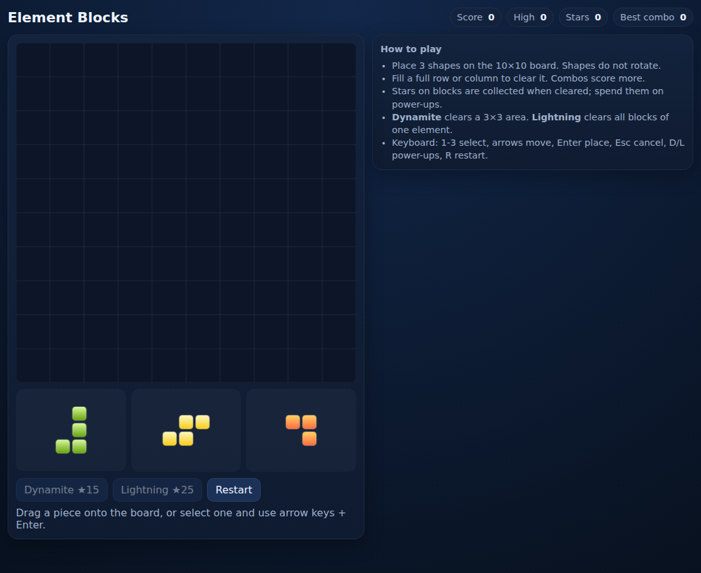

# Element Blocks

A browser-based clone inspired by [Famobi’s *Element Blocks*](https://famobi.com/) (1010-style block puzzle with elemental theme). Place shapes on a 10×10 board, clear full rows/columns, collect stars, and use power-ups to survive as long as possible.



**Play (GitHub Pages):** https://gerrcass.github.io/block-element-puzzle/  
*(Deploys from `main` via GitHub Actions. If it 404s, set repo **Settings → Pages → Source = GitHub Actions** and run the deploy workflow.)*

## Gameplay
- **Goal:** Score points by placing pieces and clearing lines. The run ends when no current tray piece fits anywhere on the board.
- **Board/Tray:** 10×10 grid, 3 pieces at a time, **no rotation**.
- **Clearing:** Completing a full row or column clears it. One placement can clear multiple lines (combo). Intersections are removed once.
- **Elements:** Blocks use five nature themes — fire, water, earth, lightning, light.
- **Stars:** Some piece blocks carry ★. Clear the line containing that block to collect stars.
- **Power-ups** (cost escalates per use in a run, max 1 held each):
  - **Dynamite** (★15+): clears a 3×3 area you choose.
  - **Lightning** (★25+): clears all blocks of the element you choose.

## Controls
- **Mouse/touch:** Drag a tray piece onto the board. Invalid placements are rejected.
- **Select & place:** Click a tray piece, then click a board cell (keyboard-friendly fallback).
- **Keyboard:** `1-3` select tray piece, arrow keys move ghost, `Enter` place, `Esc` cancel, `D`/`L` power-ups, `R` restart.
- **HUD/ARIA:** Live status updates for score, clears, stars, and game state.

## Development
```bash
npm install
npm run dev        # Vite dev server
npm test           # Vitest (core rules)
npm run typecheck  # TypeScript
npm run build      # production build (dist/)
npm run preview    # preview build
```

## Tech & architecture
- Vite + TypeScript static app (deployable to GitHub Pages).
- Pure `src/core/` rules engine (board, placement, clears, refill, game-over, stars/power-ups) with injectable RNG and Vitest unit tests.
- `src/ui/` canvas renderer + pointer/keyboard input.

## Project docs
- [Spec](docs/design/spec.md) · [Grill session](docs/design/grill-session.md) · [Glossary](GLOSSARY.md) · [ADR 0001](docs/adr/0001-deterministic-core-canvas-view.md)
- Tickets: `.scratch/element-blocks/issues/` (issues #2–#9).

## Attribution
Original implementation for learning/demo purposes. Inspired by *Element Blocks* by Famobi; no copyrighted Famobi art, audio, or proprietary assets are included. Created in [T3 Code](https://t3.codes).
